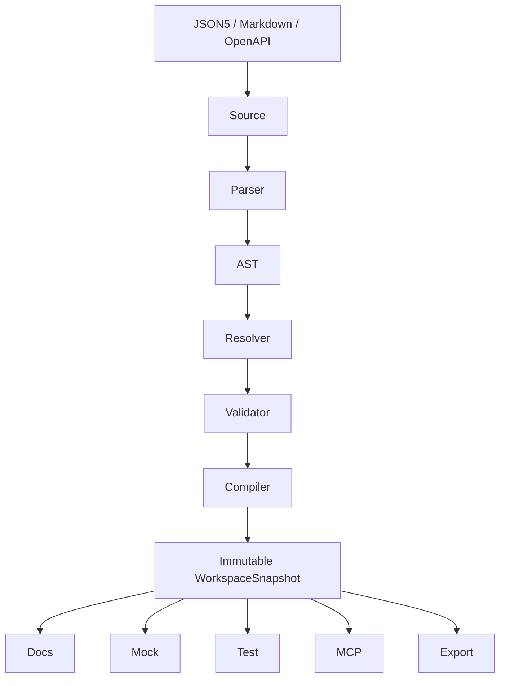

# Panda API 2.0 — 2026 全新产品与技术架构设计

**文档状态：** Panda API 2.0 新架构基线
**设计日期：** 2026-08-27
**Codex 执行模式：** **计划模式**
**项目策略：** Greenfield Rewrite（全新重写），不是 Panda API 0.7.4 原地升级

---

# 1. 项目重新定义

Panda API 2.0 不再定义为一个简单的「API 文档工具」。

新的产品定位：

> **Panda API 2.0 = API Contract Workbench**
>
> 一个面向开发者、前端、后端、测试、CI 和 AI Coding Agent 的统一 API Contract 开发平台。

它围绕一份统一的 API Contract，同时提供：

* API 文档；
* Mock Server；
* Request Runner；
* Scenario / Case；
* 后端接口自动测试；
* Schema Validation；
* OpenAPI 导入与导出；
* AsyncAPI 扩展；
* 实时文件热更新；
* MCP Server；
* AI Agent 可读取的结构化 API 能力；
* Git-native API Contract 管理；
* 后续可扩展 WASM Plugin。

---

# 2. Panda 0.7.4 的处理原则

现有 Panda API 0.7.4 的价值主要来自：

1. JSON5 DSL；
2. 文档即服务；
3. API 定义、Mock 与测试数据共用；
4. 文件即 Source of Truth；
5. 与 Git 一起版本管理。

当前项目本身已经不适合作为 2.0 的代码基础。

现有分析确认，0.7.4 是 Rust 单体 CLI，同时承担文档解析、文档服务器、Mock Server 和测试客户端；核心逻辑集中、测试稀缺，并存在构建、安全和维护问题。

旧架构实际上同时把「文档编译器、文档服务器、Mock Server、测试客户端」四种角色放进同一进程和 binary。

因此 Panda API 2.0 明确采用：

```text
旧代码
    ↓
冻结 / Archive / 行为参考
    ↓
Fixtures + Golden Tests + Migration Source

新代码
    ↓
全新 Rust Cargo Workspace
    ↓
Panda API 2.0
```

## 2.1 不允许

不要执行：

```text
Actix 2 → Actix 4
Vue 2 → Vue 3
db.rs 拆模块
api.rs 拆模块
继续修改 Database
继续兼容旧 HTTP 内部 API
```

然后试图一步步「升级」成 2.0。

## 2.2 应该执行

建立：

```text
Panda 0.7
    │
    └── legacy importer / migration fixtures

Panda 2.0
    │
    └── 全新实现
```

旧 0.7 文档必须保留为历史事实，不允许修改成看起来像 2.0 已经实现。

建议最终目录：

```text
docs/
├── README.md
├── 2.0/
│   ├── 00-overview.md
│   ├── 01-architecture.md
│   ├── 02-dsl.md
│   ├── 03-runtime.md
│   ├── 04-mock-and-test.md
│   ├── 05-security.md
│   ├── 06-mcp.md
│   └── 07-roadmap.md
└── legacy/
    └── 0.7/
        ├── project-analysis.md
        ├── architecture.md
        ├── syntax-reference.md
        └── improvement-roadmap.md
```

现有文档明确描述的是 `0.7.4 / 7deff42`，不能直接改写成 2.0 实现事实。

---

# 3. 总体技术原则

Panda API 2.0 必须坚持以下原则。

## 3.1 Contract First

所有能力围绕：

```text
API Contract
```

展开。

而不是围绕：

```text
HTTP Handler
```

展开。

---

## 3.2 Compiler Architecture

JSON5 文件不是 Runtime 数据库。

正确流程：

```text
Source Files
     ↓
Parser
     ↓
AST
     ↓
Resolver
     ↓
Validator
     ↓
Compiler
     ↓
Immutable WorkspaceSnapshot
     ↓
Runtime
```

HTTP 请求期间不得重新理解 JSON5。

---

## 3.3 Core 与 Framework 解耦

`panda-core`：

**不得依赖：**

* Axum；
* Tower；
* Hyper；
* Tokio HTTP；
* Reqwest；
* notify；
* 当前工作目录；
* 浏览器；
* React；
* Tauri。

Core 必须是可以完全通过内存对象测试的纯 Rust library。

这个方向与现有架构分析提出的 `panda-core / workspace / http / cli / web` 分层目标一致，但 2.0 直接按新项目完整实现。

---

# 4. 2026 正式技术栈

截至 2026-08-27，Panda API 2.0 使用以下技术基线。

| 层                  | 技术选择                                 |
| ------------------ | ------------------------------------ |
| Backend Language   | **Rust 1.98 Stable**                 |
| Rust Edition       | **2024**                             |
| Async Runtime      | **Tokio 1.53.x**                     |
| HTTP Framework     | **Axum 0.8.x**                       |
| HTTP Core          | **Hyper 1.x，仅底层依赖**                  |
| Middleware         | **Tower 0.5.x**                      |
| HTTP Middleware    | **tower-http 0.7.x**                 |
| HTTP Client        | **Reqwest 0.13.x**                   |
| CLI                | **Clap 4.x**                         |
| Serialization      | **Serde 1.x**                        |
| Canonical JSON     | **serde_json 1.x**                   |
| Panda JSON5 Source | **json-five 0.3.x**                  |
| YAML Import        | **serde-saphyr 1.1.x**               |
| Schema Standard    | **JSON Schema 2020-12**              |
| Schema Validator   | **jsonschema 0.50.x**                |
| HTTP Contract      | **OpenAPI 3.2.0**                    |
| Event Contract     | **AsyncAPI 3.1.0**                   |
| File Watcher       | **notify 8.2.x stable**              |
| Snapshot Swap      | **arc-swap 1.9.x**                   |
| Error Types        | **thiserror 2.x**                    |
| CLI Diagnostics    | **miette 7.x**                       |
| Logging            | **tracing**                          |
| Telemetry          | **OpenTelemetry，可选 Feature**         |
| MCP                | **官方 RMCP 3.x**                      |
| Frontend           | **React 19.2**                       |
| Frontend Language  | **TypeScript 6.0**                   |
| Build System       | **Vite 8.1 / Rolldown**              |
| CSS                | **Tailwind CSS 4.3**                 |
| Components         | **shadcn/ui + Base UI**              |
| Router             | **TanStack Router**                  |
| Server State       | **TanStack Query v5**                |
| Code Editor        | **Monaco Editor，Lazy Load**          |
| Frontend Unit Test | **Vitest 4.x**                       |
| E2E                | **Playwright 1.x 最新稳定版**             |
| Rust Test          | **cargo-nextest + proptest + insta** |
| Fuzz               | **cargo-fuzz**                       |
| Desktop Future     | **Tauri 2.x**                        |
| Plugin Future      | **WASM Component Model + WASI**      |

Rust 1.98.0 于 2026-08-20 发布；Tokio 当前稳定线为 1.53.1，Axum 为 0.8.9。

Tower 当前为 0.5.3，tower-http 为 0.7.0。Axum 本身就明确基于 Tower middleware 生态，因此这一组合不是历史惯性，而仍然是当前适合 Panda 的组合。

---

# 5. 依赖版本策略

架构文档不要把 patch version 当成永远不可改变的架构要求。

例如：

```toml
tokio = "1"
axum = "0.8"
tower = "0.5"
tower-http = "0.7"
reqwest = "0.13"
```

具体构建通过：

```text
Cargo.lock
```

固定实际验证版本。

必须：

```text
✓ 提交 Cargo.lock
✓ 提交 rust-toolchain.toml
✓ cargo build --locked
✓ cargo test --locked
```

旧 Panda 恰恰因为 binary 项目没有可靠锁定依赖，导致现代环境重新解析旧依赖后无法稳定构建。

前端同理：

```text
package.json
pnpm-lock.yaml
Node LTS
```

必须进入 CI。

---

# 6. 为什么继续使用 Tokio + Axum + Tower

经过重新审计，不因为「追新」而替换这一组合。

## Tokio

Panda 需要：

```text
HTTP
WebSocket
SSE
File IO
Timers
Process
MCP
Reqwest
Background Compilation
```

Tokio 当前仍然是最完整的 Rust async ecosystem。

---

## Axum

Panda 需要：

```text
Router
Extractors
WebSocket
Streaming
Middleware
Request Limit
Catch-all Mock Routes
Tracing
```

而不需要传统：

```text
MVC
ORM
Template
Session-oriented Web Framework
```

Axum 的职责与 Panda Runtime 高度吻合。

---

## Tower

所有：

```text
timeout
request id
trace
CORS
compression
body limit
sensitive headers
CSRF
authorization
```

统一使用 Tower Service / Layer。

tower-http 0.7 已提供包括 CORS、CSRF、limit、request-id、sensitive-headers、timeout、trace 等 HTTP middleware。

禁止自己再实现一套 Panda Middleware Framework。

---

# 7. Cargo Workspace

项目直接采用 Cargo Workspace：

```text
panda-api/
│
├── Cargo.toml
├── Cargo.lock
├── rust-toolchain.toml
│
├── crates/
│   │
│   ├── panda-core/
│   │
│   ├── panda-source/
│   │
│   ├── panda-dsl/
│   │
│   ├── panda-schema/
│   │
│   ├── panda-compiler/
│   │
│   ├── panda-workspace/
│   │
│   ├── panda-mock/
│   │
│   ├── panda-test/
│   │
│   ├── panda-openapi/
│   │
│   ├── panda-asyncapi/
│   │
│   ├── panda-runtime/
│   │
│   ├── panda-mcp/
│   │
│   └── panda-cli/
│
├── web/
│
├── fixtures/
│   ├── panda-2/
│   └── panda-0.7/
│
├── compatibility/
│   └── panda-0.7/
│
└── docs/
```

---

# 8. 每个 crate 的职责

## panda-core

仅定义核心领域类型：

```text
Contract
Route
Operation
Schema
Parameter
Request
Response
Scenario
Server
Environment
Extension
Diagnostic
```

不得做：

```text
文件读取
HTTP
CLI
JSON5 parse
网络请求
Web UI
```

---

## panda-source

负责源代码抽象：

```text
SourceFile
SourceSpan
SourceId
SourceMap
SourceText
```

保证所有错误可以最终映射：

```text
contract/auth.json5
line 31
column 12
JSON Pointer /routes/3/request/body
```

---

## panda-dsl

负责：

```text
JSON5 AST
Panda AST
DSL version
Syntax compatibility
Source → AST
```

JSON5 首选：

```text
json-five
```

原因不是单纯 deserialize，而是它提供 round-trip 能力，可支持保留注释的 formatter/migration。当前 `json-five 0.3.1` 明确定位为兼容 Serde 且支持 round-trip 的 JSON5 parser。

但必须把 parser 封装在：

```rust
trait PandaSourceParser
```

之后。

**禁止让整个系统直接依赖 json-five 的内部 AST。**

在正式锁定前，必须使用 Panda 0.7 + Panda 2 fixture corpus 测试：

```text
comment preservation
escape
unicode
multiline
trailing comma
round-trip
diagnostic spans
```

如果不能满足要求，可替换 parser 而不影响 Core。

---

## panda-schema

负责：

```text
JSON Schema 2020-12
schema normalization
schema validation
format registry
Panda mock extensions
```

使用：

```text
jsonschema 0.50.x
```

当前 `jsonschema 0.50.0` 于 2026-08-20 发布。

---

## panda-compiler

负责：

```text
AST
 ↓
Resolve
 ↓
Validate
 ↓
Compile
 ↓
WorkspaceSnapshot
```

包括：

```text
$ref
imports
schema refs
route conflicts
case compilation
environment compilation
extension validation
```

---

## panda-workspace

负责：

```text
Workspace Root
WorkspacePathResolver
files
watcher
debounce
compile lifecycle
snapshot lifecycle
```

---

## panda-mock

负责：

```text
Request Matcher
Scenario Matcher
Schema Generator
Deterministic RNG
Response Builder
Mock Budget
```

---

## panda-test

负责：

```text
Test Runner
Assertions
Diff
Reports
JUnit
JSON Report
Terminal Report
```

---

## panda-openapi

负责：

```text
OpenAPI Import
OpenAPI Export
OpenAPI Validation
```

---

## panda-asyncapi

负责：

```text
AsyncAPI Import
AsyncAPI Export
Event Contract
WebSocket/SSE description
```

第一阶段可以只建立 Adapter 和 Contract Model，不要求立刻实现 Kafka/MQTT 等 Runtime。

---

## panda-runtime

唯一允许依赖：

```text
Tokio
Axum
Tower
tower-http
```

负责：

```text
Docs API
Mock HTTP
WebSocket
SSE
Static UI
health
diagnostics
```

---

## panda-mcp

唯一负责 MCP：

```text
Official RMCP
        ↓
Panda Core APIs
```

不允许自行实现 MCP wire protocol。

---

## panda-cli

负责：

```text
panda serve
panda validate
panda test
panda fmt
panda import
panda export
panda migrate
panda doctor
panda mcp
```

---

# 9. Panda Compiler

核心编译流程：



Runtime **永远只读取 Snapshot**。

---

# 10. Immutable WorkspaceSnapshot

必须彻底废弃旧架构中的：

```rust
Mutex<Database>
Arc<Mutex<ApiData>>
```

旧架构当前采用全局 `Mutex<Database>`，热更新也在全局锁内重新加载，读请求会受到影响。

新架构：

```rust
ArcSwap<WorkspaceSnapshot>
```

当前 `arc-swap 1.9.2` 专门提供原子的 `Arc` swap，非常适合 read-mostly snapshot。

流程：

```text
               HTTP Requests
                    │
                    ▼
           Arc<Snapshot V1>
                    ▲
                    │
────────────────────────────────

File Event
    ↓
debounce
    ↓
background compile
    ↓

Compile failed?
    ├── YES → 保留 V1
    │         发布 Diagnostics
    │
    └── NO
          ↓
      Snapshot V2
          ↓
       ArcSwap
          ↓
      新请求读 V2
```

---

# 11. 文件热更新

使用：

```text
notify 8.2 stable
+
debouncer
```

当前 notify 稳定版是 8.2.0；虽然已有 9.0 RC，但 Panda 正式项目不使用 RC 作为基线。

原则：

```text
不要追 pre-release
优先最新 stable
```

Watcher 必须：

* debounce；
* coalesce；
* 不在 HTTP 请求线程 compile；
* compile error 保留 last-known-good snapshot；
* UI 实时显示 compile diagnostics；
* rename/create/delete 全部测试；
* Windows/macOS/Linux 全部测试。

---

# 12. Panda DSL 2.0

Panda 继续保留 JSON5。

这是产品特色，不改成 YAML-first。

推荐：

```text
JSON5 = Panda Native Authoring Format
JSON/YAML = Interchange Format
OpenAPI = Industry Exchange Standard
```

---

# 13. DSL 版本

所有 Panda 2 文件必须存在：

```json5
{
  panda: "2.0",
}
```

禁止继续依靠「猜测」判断 DSL 版本。

---

# 14. 推荐工作区

```text
my-api/
│
├── panda.json5
│
├── apis/
│   ├── auth.panda.json5
│   └── users.panda.json5
│
├── schemas/
│   ├── user.schema.json5
│   └── error.schema.json5
│
├── docs/
│   └── authentication.md
│
├── media/
│
└── .panda/
    └── cache/
```

`.panda/cache`：

```text
可以删除
不进入 Source of Truth
默认 .gitignore
```

---

# 15. panda.json5

示例：

```json5
{
  panda: "2.0",

  info: {
    name: "User Service",
    version: "1.0.0",
    description: "User service API",
  },

  servers: {
    local: {
      url: "http://127.0.0.1:8080",
    },

    dev: {
      url: "https://dev.example.com",
    },
  },

  imports: [
    "./schemas/*.schema.json5",
    "./apis/*.panda.json5",
  ],
}
```

---

# 16. API DSL

示例：

```json5
{
  panda: "2.0",

  group: {
    name: "Users",
    order: 10,
  },

  routes: [
    {
      id: "users.get",

      name: "获取用户",

      method: "GET",

      path: "/users/{id}",

      params: {
        id: {
          in: "path",
          required: true,

          schema: {
            type: "integer",
            minimum: 1,
          },
        },
      },

      responses: {
        200: {
          description: "用户存在",

          body: {
            schema: {
              $ref: "@schemas/User",
            },
          },
        },

        404: {
          description: "用户不存在",

          body: {
            schema: {
              $ref: "@schemas/Error",
            },
          },
        },
      },
    },
  ],
}
```

---

# 17. Schema 不再自己发明基础类型

Panda 0.7 的：

```text
posint
negint
ctitle
csentence
cparagraph
```

不再作为底层 Schema 标准。

Schema 对齐：

> JSON Schema 2020-12

例如：

```json5
{
  type: "integer",
  minimum: 1,
}
```

而不是：

```json5
{
  type: "posint",
}
```

---

# 18. Panda Mock Extension

非标准 Mock 行为：

```json5
{
  type: "string",

  mock: {
    generator: "chinese-name",
  },
}
```

Canonical Contract 中保存在：

```text
Panda Extension
```

导出 OpenAPI 时：

```text
x-panda-mock
```

例如：

```yaml
x-panda-mock:
  generator: chinese-name
```

原则：

```text
Validation
=
JSON Schema

Mock Generation
=
Panda Extension
```

绝对不要再次混在一个 `type` 字段里。

---

# 19. Scenario 取代 test_data

Panda 0.7 的 `test_data` 思想必须保留。

旧行为已经支持：

```text
请求匹配 test_data
→ 返回固定 response

没有匹配
→ 根据 response schema 生成 Mock
```

并且旧版是按数组顺序选择第一个满足条件的用例。

2.0 正式升级成：

```text
Scenario
```

示例：

```json5
scenarios: [
  {
    id: "login.invalid-password",

    name: "密码错误",

    when: {
      body: {
        username: "edison",
        password: "wrong",
      },
    },

    then: {
      status: 401,

      body: {
        code: "INVALID_PASSWORD",
        message: "密码错误",
      },
    },
  },
]
```

---

# 20. Scenario = 五合一资源

同一个 Scenario 应同时用于：

```text
Documentation Example
+
Mock Response
+
Backend API Test
+
Frontend Fixture
+
Regression Test
```

即：

> Write once, use everywhere.

这是 Panda 2.0 的核心产品优势之一。

---

# 21. Request Matcher

Matcher 必须完全脱离 Axum。

输入：

```rust
RequestContext {
    method,
    path,
    headers,
    query,
    body,
    multipart,
}
```

输出：

```rust
MatchOutcome
```

匹配规则必须：

```text
deterministic
```

禁止依赖：

```text
HashMap 遍历顺序
文件系统扫描顺序
线程调度
```

---

# 22. Route Priority

建议固定：

```text
1. Exact static path
2. Parameterized path
3. Wildcard path
```

相同层级：

```text
explicit priority
↓
source order
↓
stable file path
```

如果两个 Route 无法明确区分：

```text
compile error
```

而不是 Runtime 随机选一个。

旧版当前恰恰存在重叠 URL/pattern 路由顺序不稳定问题。

---

# 23. Mock Generator

Generator 必须：

```text
Deterministic RNG
+
Seed
+
Resource Budget
```

例如：

```bash
panda serve --seed 1234
```

相同：

```text
Contract
+
Request
+
Seed
```

应能够产生相同结果。

方便：

```text
Bug reproduction
CI
Snapshot tests
Agent debugging
```

---

# 24. Mock Budget

必须存在硬限制：

```text
max_response_bytes
max_array_items
max_object_properties
max_recursive_depth
max_regex_complexity
max_delay
```

达到预算时：

```text
Structured Diagnostic
```

禁止：

```text
panic
OOM
无限递归
无限生成
```

---

# 25. HTTP Runtime

Runtime 使用：

```text
Tokio
 ↓
Axum
 ↓
Tower
 ↓
tower-http
```

架构：

```text
Incoming HTTP
     ↓
Tower Middleware
     ↓
Panda Runtime Adapter
     ↓
Snapshot
     ↓
Panda Matcher
     ↓
Scenario
     ↓
Mock Generator
     ↓
Response
```

---

# 26. Middleware

默认开启：

```text
Request ID
Tracing
Sensitive Header Redaction
Timeout
Body Limit
Compression
```

Local mode：

```text
开发 CORS
```

Public mode：

```text
Strict CORS
CSRF where applicable
Auth
Rate limit
```

---

# 27. HTTP Client

测试外部真实服务器统一：

```text
Reqwest 0.13
```

当前稳定版 0.13.4。

禁止自己直接封装 Hyper Client。

---

# 28. panda test

CLI：

```bash
panda test
```

运行整个项目。

```bash
panda test users.get
```

运行 Operation。

```bash
panda test login.invalid-password
```

运行 Scenario。

---

# 29. Assertions

支持：

```text
exact
subset
schema
```

默认：

```text
exact
```

示例：

```json5
assert: {
  status: 200,

  body: {
    mode: "schema",
  },
}
```

---

# 30. Test Reports

至少输出：

```text
Terminal
JSON
JUnit XML
```

用于：

```text
GitHub Actions
GitLab CI
Jenkins
Codex
IDE
```

任何失败：

```text
process exit != 0
```

旧 Panda 当前 `test` 只发送请求、打印响应，没有真正执行 response assertion。

2.0 必须彻底修正。

---

# 31. OpenAPI

当前标准基线：

> **OpenAPI 3.2.0**

OpenAPI 3.2.0 是当前最新发布版本。

支持：

```bash
panda import openapi.yaml

panda export openapi
```

架构：

```text
OpenAPI
    ↓
OpenAPI Adapter
    ↓
Canonical Contract Model
    ↑
Panda DSL
```

---

# 32. 不把 Rust OpenAPI crate 当内部模型

禁止：

```text
CanonicalContract = 某个 openapi crate 的 Rust Struct
```

原因：

OpenAPI crate 的版本支持可能滞后标准。

正确：

```text
Own Canonical Contract Model
+
OpenAPI Adapter
```

未知标准字段应尽量保留：

```text
extensions / unknown fields
```

防止 import/export 丢数据。

---

# 33. YAML

OpenAPI YAML 解析使用：

```text
serde-saphyr
```

不新建项目依赖 deprecated/unmaintained YAML crate。

当前 serde-saphyr 1.1.0 强调 panic-free parsing，并增加 parser resource budgets，适合解析外部提交的 API 文件。

---

# 34. AsyncAPI

Event-driven Contract 对齐：

> AsyncAPI 3.1.0

AsyncAPI 3.1 于 2026-01 发布，是当前正式 3.1 标准。

用于未来：

```text
WebSocket
SSE
Kafka
MQTT
NATS
RabbitMQ
```

但是：

## Panda 2.0 MVP

只要求：

```text
Contract Model
+
Import / Export Architecture
```

不要第一阶段就实现所有消息 Broker Runtime。

---

# 35. 删除旧 WebSocket 聊天室

旧版本的 WebSocket 实际上是：

```text
/list
/join
/name
chat room
```

并不是真正由 body/response/test_data 驱动的 WebSocket Mock。

2.0：

```text
DELETE old chat implementation
```

未来 WebSocket Contract 通过 AsyncAPI/Event Contract 实现。

---

# 36. MCP

Panda 2.0 必须将 MCP 作为重要能力。

架构：

```text
Codex
Claude Code
ChatGPT
Other Agent
      │
      ▼
Official RMCP
      │
      ▼
Panda MCP Adapter
      │
      ▼
Panda Core
```

当前官方 Rust SDK `rmcp` 已是 3.x 线，crate 当前版本 3.1.4。

---

# 37. MCP 协议版本规则

不要自己实现 MCP 协议。

也不要硬编码：

```text
永远强制使用当前最新 protocol version
```

RMCP 已在持续支持 2026-07-28 协议能力，同时官方仓库仍持续执行新版协议 conformance 工作，因此 Panda 必须依赖：

```text
RMCP negotiation
+
official conformance tests
```

而不是 Panda 自己猜测协议兼容性。

---

# 38. MCP Tools

第一阶段提供：

```text
list_projects
get_project

list_apis
search_apis
get_api

get_schema
validate_schema

validate_request
generate_example

list_scenarios
run_scenario

run_tests
get_test_result

get_diagnostics
```

---

# 39. MCP Resources

可以提供：

```text
panda://project
panda://api/{id}
panda://schema/{id}
panda://scenario/{id}
panda://diagnostics
```

Agent 不需要：

```text
grep
cat
猜目录
读整个 JSON5
```

直接获得结构化 Contract。

---

# 40. AI Agent 定位

Panda 2.0 的用户不只是人。

必须同时设计给：

```text
Human Developer
+
AI Coding Agent
```

典型流程：

```text
Codex
 ↓
Panda MCP: get_api
 ↓
修改后端
 ↓
Panda MCP: run_tests
 ↓
3 failures
 ↓
get_test_result
 ↓
继续修改
 ↓
全部通过
```

因此 Panda 2.0 是：

> **API Contract Infrastructure for Humans and Agents**

---

# 41. Web Frontend

全新开发。

不要恢复旧 Vue 2。

现有仓库只有 Vue 2 编译产物和 source maps，没有完整可维护源码工程。

新的前端：

```text
React 19.2
TypeScript 6
Vite 8.1
Tailwind 4.3
shadcn/ui
Base UI
TanStack Router
TanStack Query
Monaco
```

React 当前最新正式文档版本为 19.2；TypeScript 6.0 已在 2026-08 发布。

Vite 8.1 已使用 Rolldown 统一 bundler；Tailwind 当前为 4.3。

---

# 42. shadcn Component Base

新项目使用：

```text
shadcn/ui
+
Base UI
```

不要默认 Radix。

shadcn 已于 2026-07 将 Base UI 设为新项目默认底层；Radix 继续支持，但不再是绿地项目的默认选择。

---

# 43. Frontend State

使用：

```text
TanStack Query
=
Server State

TanStack Router
=
URL / Navigation State

React local state
=
component state
```

第一阶段：

**不引入 Redux。**

如果之后确实出现复杂的跨组件 UI 工作区状态，再评估 Zustand。

不要一开始增加没有必要的状态框架。

---

# 44. Monaco Editor

用于：

```text
JSON5
JSON
YAML
Markdown
Request Body
Response Body
```

必须：

```text
lazy-load
```

避免首页直接加载 Monaco 大 bundle。

后续为 Panda DSL 建：

```text
completion
hover
diagnostic
jump to definition
$ref navigation
```

---

# 45. UI 基本结构

```text
┌──────────────────────────────────────────────────────────┐
│ Panda API                    Local ●     Environment DEV │
├─────────────┬──────────────────────────┬─────────────────┤
│ API Tree    │ Documentation / Editor   │ Request Builder │
│             │                          │                 │
│ Auth        │ GET /users/{id}          │ Params          │
│ Users       │                          │ Headers         │
│ Orders      │ Schema                   │ Body            │
│             │ Scenarios                │                 │
│             │ Examples                 │ [ Send ]        │
├─────────────┴──────────────────────────┴─────────────────┤
│ Tests │ Mock Requests │ Diagnostics │ Compile │ History  │
└──────────────────────────────────────────────────────────┘
```

---

# 46. Docs 与 Runtime 通信

前端禁止读取 Rust 内部 Struct。

必须定义版本化 DTO：

```text
/api/v1/project
/api/v1/apis
/api/v1/apis/{id}
/api/v1/schemas/{id}
/api/v1/scenarios
/api/v1/diagnostics
```

未来 Rust Core 改结构：

```text
不会直接破坏 Web
```

---

# 47. Runtime Event Channel

用于：

```text
snapshot updated
diagnostics changed
test started
test result
mock request log
```

可以采用：

```text
WebSocket
```

或者特定单向场景：

```text
SSE
```

不要把业务 Event Contract 和 Panda 管理控制通道混成一个概念。

---

# 48. 不需要数据库

Panda Project 的 Source of Truth：

```text
Files
+
Git
```

核心不能依赖：

```text
PostgreSQL
MySQL
Redis
MongoDB
```

第一阶段也不引入 SQLite。

---

# 49. Local State

例如：

```text
最近打开 Workspace
UI Layout
Request History
```

第一阶段可以放：

```text
browser local storage
+
.panda/cache
```

以后确实需要复杂查询再增加 SQLite。

原则：

> 删除所有 Panda cache 后，项目 Contract 必须仍然完整。

---

# 50. 安全模型

Panda 0.7 已存在：

```text
任意文件读取
path traversal
upload path
token exposure
auth fail-open
```

等 P0 风险。

2.0 必须从第一天设计安全边界。

---

# 51. WorkspacePathResolver

所有文件访问：

```text
HTTP
Parser
$ref
media
upload
docs
```

必须经过：

```text
WorkspacePathResolver
```

规则：

```text
logical path
 ↓
normalize
 ↓
reject absolute
 ↓
reject ..
 ↓
canonicalize
 ↓
verify inside allowed root
 ↓
permission check
 ↓
open
```

不得：

```rust
fs::read(user_input)
```

---

# 52. 文件系统 Capability

建议定义：

```text
WorkspaceCapability

docs: read
schemas: read
media: read
temp: read/write
```

HTTP Runtime 不直接拥有：

```text
任意宿主机 filesystem capability
```

---

# 53. Upload

如果实现 Mock upload：

```text
generated UUID filename
original filename = metadata
```

必须限制：

```text
request bytes
file bytes
file count
field count
timeout
disk quota
```

失败：

```text
remove temp file
```

禁止原文件名参与实际磁盘路径。

---

# 54. Local Mode

默认：

```bash
panda serve
```

监听：

```text
127.0.0.1
```

默认：

```text
no authentication
development CORS
```

但是仅 loopback。

---

# 55. Public / Team Mode

未来如果允许：

```bash
panda serve --public
```

则必须显式配置：

```text
authentication
allowed origins
TLS/reverse proxy
rate limit
secret policy
upload policy
```

不要让：

```bash
--host 0.0.0.0
```

自动绕过安全模型。

---

# 56. Secret

真实秘密不得进入 Panda API Contract。

支持：

```json5
headers: {
  Authorization: {
    from_env: "MY_API_TOKEN",
  },
}
```

Runtime 内部保存：

```text
SecretString / redacted value
```

UI：

```text
••••••••
```

logs：

```text
[REDACTED]
```

禁止序列化到：

```text
Docs DTO
MCP response
test reports
request logs
```

---

# 57. Error Model

Core 建自己的：

```rust
Diagnostic {
    code,
    severity,
    message,
    source_id,
    span,
    json_pointer,
    help,
}
```

例如：

```text
PANDA-D001
PANDA-D002
PANDA-R001
PANDA-S001
PANDA-T001
```

---

# 58. CLI Error Rendering

Core：

```text
Diagnostic DTO
```

CLI：

```text
miette
```

渲染：

```text
error[PANDA-R004]: conflicting route

  ┌─ apis/users.panda.json5:42:5
  │
42│ path: "/users/{id}"
  │       ^^^^^^^^^^^^^ conflicts with users.detail
  │
  = help: add explicit route priority or remove ambiguity
```

---

# 59. 日志

默认：

```text
tracing
+
tracing-subscriber
```

禁止散落：

```rust
println!()
dbg!()
```

日志字段：

```text
request_id
workspace_id
route_id
scenario_id
duration
status
```

不得记录：

```text
password
token
Authorization
cookie
secret body field
```

---

# 60. OpenTelemetry

第一阶段不要默认把 OpenTelemetry 整体引入 binary。

使用 Feature：

```toml
[features]
otel = [...]
```

默认：

```text
tracing only
```

Team/CI：

```text
OTLP optional
```

保持本地 `panda` 二进制轻量。

---

# 61. CLI

最终 CLI：

```bash
panda
```

等价：

```bash
panda serve
```

---

## validate

```bash
panda validate
panda validate --strict
```

---

## test

```bash
panda test
panda test users.get
panda test login.success
```

---

## fmt

```bash
panda fmt
panda fmt --check
```

尽量保留 JSON5 comments。

---

## import

```bash
panda import openapi.yaml
```

---

## export

```bash
panda export openapi
panda export asyncapi
```

---

## migrate

```bash
panda migrate --from 0.7
```

---

## doctor

```bash
panda doctor
```

检查：

```text
Workspace
DSL
refs
permissions
version
environment
```

---

## mcp

```bash
panda mcp
```

启动 MCP Server。

也可以：

```bash
panda serve --mcp
```

由实现阶段根据 RMCP transport 设计确定。

---

# 62. Single Binary

最终 release 用户：

```bash
brew install panda-api
```

或者下载：

```text
panda
```

运行：

```bash
cd project
panda
```

浏览器访问：

```text
http://127.0.0.1:9000
```

用户不需要：

```text
Node
pnpm
Python
Java
PostgreSQL
Redis
```

---

# 63. Web Assets

开发：

```text
web/
 ↓
Vite Dev Server
```

Release：

```text
pnpm build
 ↓
static assets
 ↓
embed into Rust binary
```

最终只有：

```text
panda
```

一个主要可执行文件。

具体 embed crate 应比较当前稳定方案后选择，不把它放进 core。

---

# 64. Rust 测试体系

使用：

```text
cargo-nextest
proptest
insta
cargo-fuzz
```

测试层级：

```text
Parser Unit
Resolver Unit
Schema Unit
Matcher Table Tests
Generator Property Tests
Scenario Tests
HTTP Integration
CLI Integration
MCP Contract Tests
End-to-End
Legacy Migration Golden Tests
```

---

# 65. Golden Fixtures

必须把现有 Panda 0.7 文档与示例转换成：

```text
fixtures/panda-0.7/
```

建立：

```text
Parser fixtures
Legacy behavior fixtures
Migration expected output
```

目的是：

```text
迁移时知道发生了什么变化
```

而不是要求 2.0 永远复制旧 bug。

---

# 66. Frontend Test

使用：

```text
Vitest
+
Playwright
```

Playwright 测：

```text
project load
API navigation
edit
diagnostic
send request
mock
run tests
hot reload
```

---

# 67. CI

必须执行：

```text
cargo fmt --check
cargo clippy
cargo nextest run
cargo test --doc

panda fixture tests
migration tests

frontend lint
frontend typecheck
vitest
playwright

cargo audit / cargo deny

Linux build
macOS build
Windows build
```

---

# 68. Supply Chain

发布必须：

```text
Cargo.lock
frontend lockfile
checksums
SBOM
signed artifacts
```

Release：

```text
Linux x86_64
Linux arm64 where required
macOS arm64
macOS x86_64 if maintained
Windows x86_64
```

根据实际用户统计决定最终 target matrix。

---

# 69. Performance Architecture

目标不是「极限 Benchmark」。

目标：

```text
启动快
低内存
Mock latency 极低
热更新不阻塞
大型 Contract 可用
```

必须建立 benchmark fixtures：

```text
100 APIs
1,000 APIs
10,000 APIs
```

测：

```text
parse time
compile time
snapshot size
route lookup
mock generation
reload time
```

不要现在凭感觉写死不现实的性能数字。

先建立 benchmark baseline，再确定 release gate。

---

# 70. Legacy Migration

提供：

```bash
panda migrate --from 0.7
```

迁移：

```text
test_data
→
scenarios

response model
→
JSON Schema

posint
→
integer + minimum

csentence
→
string + x-panda-mock

_auth
→
新的 mock security / environment model

_settings
→
panda.json5
```

---

# 71. Migration Report

迁移不能静默。

必须输出：

```text
converted
warning
unsupported
manual action required
```

例如：

```text
WARN PANDA-M013

Old field:
auth_place: "query"

Panda 0.7 runtime never reliably implemented this behavior.

Migration:
not converted automatically.

Action:
configure Panda 2 authentication explicitly.
```

---

# 72. 0.7 Compatibility 原则

不要求 Panda 2 Runtime 永久直接执行全部旧 DSL。

推荐：

```text
Legacy Loader
      ↓
Legacy AST
      ↓
Migrator
      ↓
Panda 2 AST
```

而不是：

```text
新 Runtime 里面到处 if legacy
```

这样可以避免永久技术债。

---

# 73. 开发里程碑

## M0 — Repository Reset / Architecture Foundation

目标：

```text
建立新 Workspace
保留旧代码 Archive
建立 CI
建立 2.0 docs
```

完成：

```text
Cargo Workspace
Rust 2024
Cargo.lock
toolchain
lint
CI
basic crates
```

---

# 74. M1 — Compiler Core

实现：

```text
SourceMap
JSON5 parser adapter
Typed AST
Canonical Contract
Resolver
Diagnostics
Compiler
Immutable Snapshot
```

此阶段：

**不优先开发漂亮 UI。**

---

# 75. M2 — HTTP Mock Runtime

实现：

```text
Axum
Tower
Matcher
Scenario
Mock Generator
Hot Reload
ArcSwap
```

达到：

```text
JSON5 编辑
→
自动 compile
→
Mock 服务即时更新
```

---

# 76. M3 — Test Runner

实现：

```text
Reqwest
Assertions
Diff
Reports
panda test
```

达到：

```text
Scenario
=
Mock
+
Automated API Test
```

---

# 77. M4 — Web Workbench

实现：

```text
React
TypeScript
Vite
Tailwind
shadcn/Base UI
TanStack
Monaco
```

达到完整 API Workbench。

---

# 78. M5 — OpenAPI

实现：

```text
OpenAPI 3.2 import
OpenAPI export
validation
round-trip fixture
```

---

# 79. M6 — MCP

实现：

```text
RMCP
tools
resources
diagnostics
test execution
```

完成：

```text
Codex ↔ Panda
```

闭环。

---

# 80. M7 — Legacy Migrator

实现：

```text
panda migrate --from 0.7
```

并对旧仓库示例执行自动迁移测试。

---

# 81. M8 — AsyncAPI / Event Contract

之后再增加：

```text
WebSocket
SSE
AsyncAPI
```

不要阻塞 HTTP 2.0 MVP 发布。

---

# 82. M9 — Plugin System

Core 稳定以后，再研究：

```text
WASM Component Model
WASI
Wasmtime
```

第一阶段：

**不实现 plugin runtime。**

只预留：

```text
extension namespace
extension registry
future plugin boundary
```

---

# 83. 明确不进入 2.0 MVP 的东西

不要第一阶段做：

```text
云同步
多人协作
账号系统
PostgreSQL
Kafka Runtime
MQTT Runtime
完整 gRPC
WASM Plugin Marketplace
复杂 RBAC
AI 自动生成整个 Backend
Tauri Desktop
```

保持 Panda 2.0 第一版：

> 快、稳、轻、Contract First。

---

# 84. Architecture Dependency Rule

必须通过 CI 或 review 保证：

```text
panda-core
    ↓
不得依赖 Framework
```

推荐 dependency direction：

```text
source
   ↓
dsl
   ↓
core
   ↑
compiler

workspace → compiler
mock      → core
test      → core
openapi   → core
asyncapi  → core

runtime   → core + mock + workspace
mcp       → core + test
cli       → everything through public API
```

禁止循环依赖。

---

# 85. 公共 API

Core 应最终形成类似：

```rust
compile_workspace(...)
    -> Result<WorkspaceSnapshot, DiagnosticSet>

validate_workspace(...)
    -> DiagnosticSet

match_request(...)
    -> MatchOutcome

generate_response(...)
    -> Result<GeneratedResponse, Diagnostic>

run_scenario(...)
    -> ScenarioResult
```

名称可以调整。

职责不能改变。

---

# 86. Version Model

至少存在三个版本概念：

```text
Panda CLI Version
Panda DSL Version
Contract Exchange Version
```

例如：

```text
CLI
2.0.0-alpha.1

DSL
2.0

OpenAPI
3.2.0
```

不要继续把所有东西混成一个版本号。

---

# 87. Health

Runtime：

```text
GET /api/v1/health
```

至少返回：

```json
{
  "status": "ok",
  "version": "...",
  "snapshot": {
    "valid": true,
    "revision": 42
  }
}
```

不能泄露：

```text
绝对磁盘路径
secret
token
```

---

# 88. Diagnostics

前端必须能看到：

```text
Last successful compile
Current source revision
Errors
Warnings
```

无效编辑：

```text
不会把正在工作的 Mock Server 弄挂
```

继续运行：

```text
Last Known Good Snapshot
```

并在 UI 显示：

```text
Current source invalid
Runtime using previous valid snapshot
```

---

# 89. 产品核心闭环

最终 Panda 2.0 应形成：

```text
             Panda Contract
                   │
     ┌─────────────┼─────────────┐
     │             │             │
     ▼             ▼             ▼
   Human          CI           Agent
     │             │             │
     ▼             ▼             ▼
   Docs           Test          MCP
     │             │             │
     └───────┬─────┴──────┬──────┘
             │            │
             ▼            ▼
           Mock        Validation
             │            │
             └─────┬──────┘
                   ▼
             Same Contract
```

---

# 90. Panda API 2.0 的核心价值

以前 Panda API 解决：

> 前端和后端如何共享 API 信息。

Panda API 2.0 应解决：

> **前端、后端、测试、CI、文档系统和 AI Coding Agent 如何共享同一份 API 真相。**

最终 Source of Truth：

```text
Panda Contract
```

而不是：

```text
后端代码一份
Swagger 一份
Mock 一份
Postman 一份
测试代码一份
AI Context 又一份
```

---

# 91. 最终技术决策摘要

正式锁定：

### 后端

```text
Rust 1.98
Edition 2024
Tokio
Axum
Tower
tower-http
Reqwest
```

### Contract

```text
Panda JSON5
JSON Schema 2020-12
OpenAPI 3.2
AsyncAPI 3.1
```

### Runtime

```text
Compiler Architecture
Immutable Snapshot
ArcSwap
notify
```

### Frontend

```text
React 19.2
TypeScript 6
Vite 8.1
Tailwind 4.3
shadcn/ui + Base UI
TanStack Router
TanStack Query
Monaco
```

### Agent

```text
Official RMCP
Panda MCP Server
```

### Persistence

```text
Files + Git
No Core Database
```

### Future

```text
WASM Component Model
Tauri
Async event runtimes
```

---

# 92. Codex 执行要求

请先进入 **计划模式**。

不要收到本文后立即大范围修改代码。

第一步完整审计当前 repository：

```text
source
Cargo
docs
examples
_theme
legacy blogs
tests
CI
release
```

然后输出：

```text
Current Repository State
Target Repository State
Migration Map
Files to Keep
Files to Archive
Files to Delete
New Workspace Layout
Implementation Phases
Risk List
```

---

# 93. Codex 第一阶段任务

首先只完成：

```text
1. 保存 Panda 0.7 历史资料
2. 建立 docs/legacy/0.7
3. 建立 docs/2.0
4. 把本文作为 Panda 2.0 Architecture Source of Truth
5. 创建新的 Cargo Workspace
6. 创建 crate skeleton
7. 建立 Rust 1.98 / Edition 2024
8. 提交 Cargo.lock
9. 建立 CI
10. 确保空架构 build/test 全绿
```

不要第一阶段就开始写 Mock Generator。

---

# 94. 每阶段执行纪律

每个 milestone：

```text
Plan
↓
Implement
↓
Test
↓
Review
↓
Documentation Update
↓
Commit
```

禁止：

```text
一次性实现 M0-M9
```

---

# 95. 技术选型动态规则

本文记录的是：

> **2026-08-27 当前稳定技术基线。**

Codex 真正写入依赖前必须：

1. 查看对应官方文档；
2. 查看 crates.io / npm 当前 stable；
3. 不使用 RC / beta / nightly，除非本文明确允许；
4. 比较 MSRV；
5. 检查维护状态；
6. 检查 license；
7. 检查安全 advisory；
8. 运行最小 PoC；
9. 再写入 lockfile。

如果 patch version 已更新：

```text
允许使用当前 compatible stable patch
```

如果出现：

```text
major version
架构级变化
breaking change
```

不要自行升级。

先在计划中说明：

```text
当前文档选择
最新候选
差异
收益
风险
迁移成本
推荐结论
```

再决定。

---

# 96. Definition of Done

Panda API 2.0 第一阶段真正完成必须至少满足：

* Rust 2024 Cargo Workspace 建立；
* Core 与 HTTP Framework 完全解耦；
* Panda JSON5 可以解析为 Typed AST；
* JSON Schema 2020-12 Validation 正常；
* Contract Compiler 正常；
* Immutable WorkspaceSnapshot 正常；
* 热更新采用 compile + ArcSwap；
* 编译失败保留 Last Known Good Snapshot；
* Mock Matcher deterministic；
* Scenario 同时支持 Mock 与 Test；
* `panda validate` 可用；
* `panda test` 有真实 assertions 与 exit code；
* OpenAPI 3.2 可以 import/export；
* Web UI 为全新 React/TS 架构；
* MCP 使用官方 RMCP；
* Workspace 文件无法越界访问；
* secret 不会出现在 docs/log/MCP；
* Linux/macOS/Windows CI build；
* Cargo.lock 和前端 lockfile 均进入版本控制；
* Panda 0.7 有明确迁移路径；
* 旧文档归档，新文档成为 2.0 Source of Truth。

---

# 97. 最终要求

不要把 Panda API 2.0 做成：

> 「一个换了 Rust 新版本和 React 的 Panda API 0.7」。

应该重新理解产品：

> **Panda API 2.0 是一个 Contract Compiler + Mock Runtime + Test Engine + Developer Workbench + Agent Interface。**

它服务的不只是 API 文档展示。

它应该成为：

> **API 的统一事实来源和可执行契约。**

所有技术设计都围绕这一目标展开。
