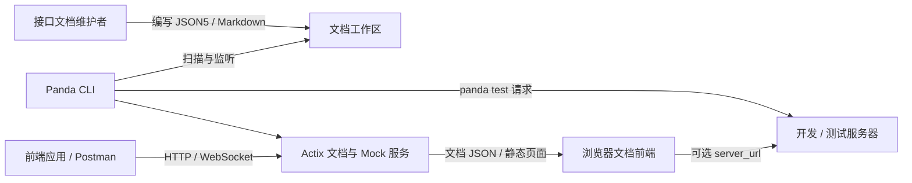
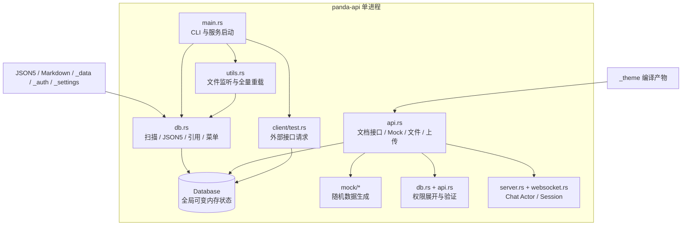
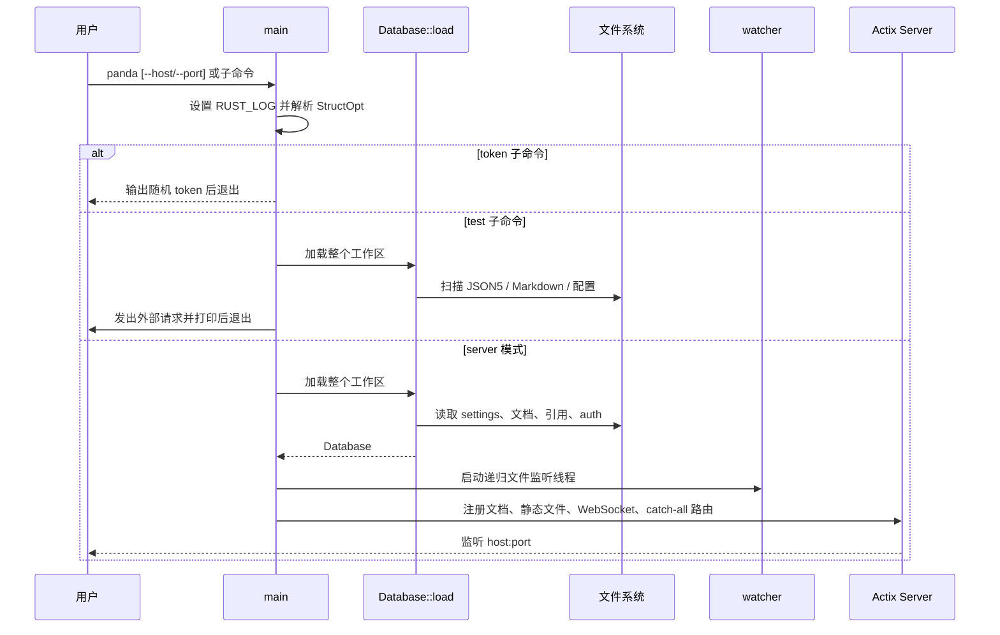
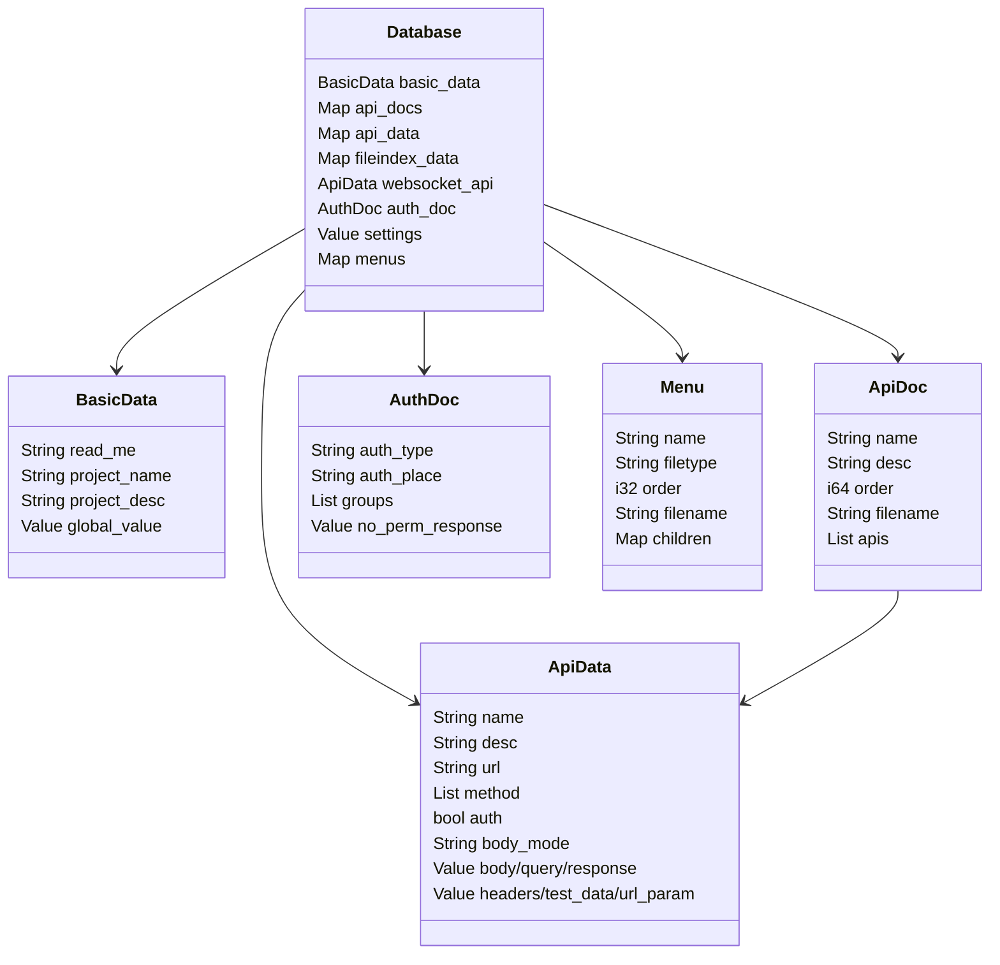
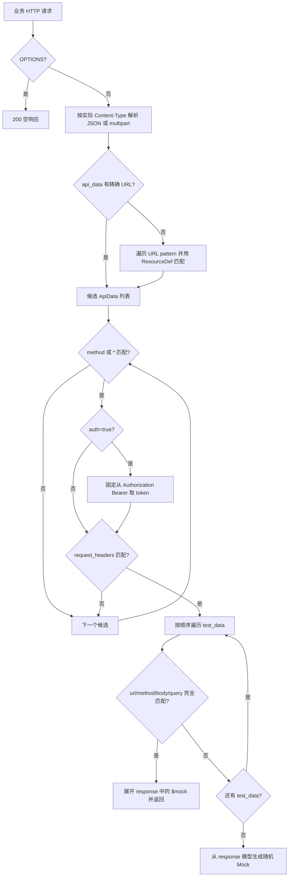
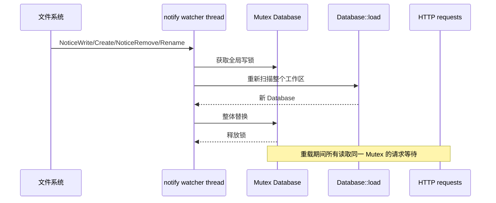
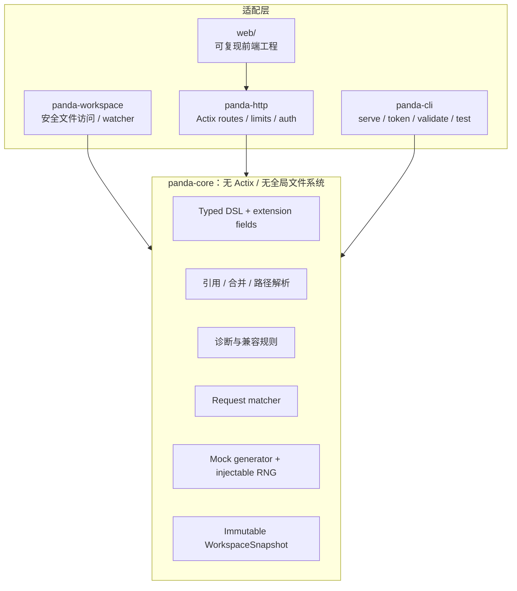

# Panda API 系统架构

## 1. 架构范围

本文描述 Panda API 0.7.4 在提交 `7deff42` 上的实际架构，并给出保持 JSON5 DSL 兼容的目标架构。现状描述来自 Rust 源码和 `_theme/js/*.map` 中的前端源码内容；目标架构是改进建议，不代表当前已经实现。

## 2. 系统上下文



Panda API 同时承担四种角色：

1. 文档编译器：把 JSON5、Markdown 和目录结构转换为内存模型；
2. 文档服务器：为内置 Vue 前端提供项目、菜单和接口数据；
3. Mock 服务器：按固定测试数据或字段模型响应任意业务路由；
4. 测试客户端：从 `test_data` 取请求数据并调用外部服务器。

这四个角色目前都编译进同一个进程和 binary，没有独立库边界。

## 3. 当前运行时组件



### 3.1 组件职责

| 组件 | 输入 | 输出 | 当前边界问题 |
| --- | --- | --- | --- |
| CLI/启动 | 命令行、环境变量、当前目录 | token、测试请求或 HTTP server | 命令解析、工作区加载和服务装配耦合 |
| Loader | 文件系统和 JSON5 | `Database` | 解析、合并、权限、菜单、索引在同一模块 |
| Watcher | 文件系统事件 | 新 `Database` | 每个相关事件都在全局锁内全量重载 |
| 文档 API | `Database` | 项目、菜单、接口、设置和认证 JSON | 文件路径直接来自请求；内部模型直接序列化 |
| Mock Router | HTTP request + `ApiData` | 固定或随机 response | 匹配、认证、生成和 HTTP adapter 不可独立测试 |
| Mock Generator | 动态 `Value` 模型 | 随机 `Value` | 无可注入随机源、统一验证和资源上限 |
| WebSocket | 单个配置 URL、消息 | 房间广播 | 固定聊天协议，不是 DSL 驱动的通用 Mock |
| Test Client | `test_data`、server URL | 日志 | 没有 assertion、报告或失败退出语义 |
| Vue 前端 | 文档 JSON、远端服务器 | 在线文档与请求界面 | 只有构建产物，没有可复现源码工程 |

## 4. 启动与加载流程



### 4.1 文件发现规则

- 从进程当前目录 `./` 递归扫描；当前目录就是一个 Panda API 文档工作区。
- `README.md` 只作为项目首页，不进入 Markdown 菜单。
- 所有其他 `.md` 进入菜单，`$_folder.md` 只配置父目录菜单。
- 只有 `.json5` 会被当成接口文档；`_settings.json5`、`_auth.json5`、`_data/`、隐藏路径被排除。
- `.gitignore` 同时影响扫描库和 watcher 的忽略判断，但缺失或错误时没有统一诊断。

### 4.2 合并与索引

每个接口最终转换成一个 `ApiData`。标量字段通常按以下优先级取值：

```text
接口自身 > 接口级 $ref > _settings.global.apis > 内置默认值
```

`response` 会先合并全局字段，再合并接口级 `$ref`，最后合并当前接口字段；随后递归处理模型 `$ref`、include/exclude、删除和嵌套路径覆盖。

Loader 建立两套主要索引：

- `api_docs: HashMap<filename, ApiDoc>`：供在线文档按文件读取；
- `api_data: HashMap<url, Vec<ApiData>>`：供动态 Mock 路由按 URL 查找。

`fileindex_data` 记录模型文件到引用文档的反向关系，但现有 watcher 在使用它之前已经全量重载并返回。

## 5. 核心状态模型



共享状态类型是 `web::Data<Mutex<Database>>`，而 `ApiData` 又包在 `Arc<Mutex<ApiData>>` 中。绝大多数运行时数据在加载完成后实际只读，却仍使用可变锁。

## 6. HTTP 边界

路由在 [`src/main.rs`](../../../compatibility/panda-0.7/src/main.rs) 中按顺序注册。

| Method/路径 | Handler | 用途 | 当前风险或限制 |
| --- | --- | --- | --- |
| `GET /__api_docs/` | `get_api_doc_basic` | 项目、README、菜单摘要 | 返回顺序交给前端排序 |
| `GET /__api_docs/api_data/?filename=...` | `get_api_doc_data` | JSON5、Markdown、settings、auth 详情 | filename 未限定在工作区；auth 包含 token |
| `GET /__api_docs/_data/?filename=...` | `get_api_doc_schema_data` | 读取模型原文 | 可读取任意进程可访问文本路径 |
| `GET /__api_docs/theme/*` | `theme_view` | 主题静态文件 | 手工路径拼接 |
| `GET /` | `theme_view` | 主题首页 | 优先工作区 `_theme`，再使用用户安装目录主题 |
| `GET /media/*` | `static_file_view` | Markdown 图片等 | 未规范化并验证 media 根目录 |
| `GET /_upload/*` | `upload_file_view` | 访问上传文件 | 未规范化并验证 `_data/_upload` 根目录 |
| 配置的 WebSocket URL | `websocket_handle` | 聊天房间 WebSocket | 只保留最后加载的一个 WebSocket API |
| `* /*` | `action_handle` | 所有业务 Mock 请求 | catch-all 与前述路由共享同一服务 |

服务默认添加：

```text
Panda-Api: 0.5
Access-Control-Allow-Headers: *
Access-Control-Allow-Origin: *
Access-Control-Allow-Methods: *
```

Header 中的版本号与 crate 版本 `0.7.4` 不一致。

## 7. Mock 请求处理流程



关键语义：

- URL 先做精确 HashMap 查询，失败后才遍历 pattern；多个 pattern 命中时顺序不稳定。
- `body` 和转换后的 `query` 与测试用例要求完全相等；请求多一个字段也不匹配。
- `test_data` 按数组顺序返回第一个匹配项。
- 配置的 `body_mode` 不参与请求校验；解析方式取决于实际 `Content-Type`。
- 未匹配测试数据且 `response` 为空时返回错误 JSON，否则生成随机数据。
- 认证、未找到 URL、method 不匹配等业务错误通常仍使用 HTTP 200。

## 8. 热更新架构



`utils.rs` 中保留了一套按文件增量更新的代码，但在全量重载后的 `return` 之后，当前不可执行。文件系统常会为一次保存发出多个事件，因此同一编辑可能触发多次完整重载。

## 9. WebSocket 架构

当任意 API 的 method 包含 `WEBSOCKET` 时，Loader 把该 `ApiData` 写入单一 `websocket_api`；后加载的配置覆盖此前值。HTTP server 只为这个 URL 注册 `WsChatSession`。

Session 行为固定为：

- 连接后自动加入 `Main` 房间；
- 每 5 秒 ping，10 秒无 pong 断开；
- `/list` 列出房间；
- `/join <room>` 切换房间；
- `/name <name>` 设置显示名；
- 其他文本广播到当前房间；binary 和 continuation 不支持。

API 的 body、response、test_data 不驱动 WebSocket 消息。这是一个内置聊天室，而非面向业务协议的 WebSocket Mock 引擎。

## 10. 目标架构

目标是在不改变 0.7.x DSL 的前提下，把解析、匹配和生成行为变成可测试的核心库，并把文件系统、HTTP、CLI 和前端放到适配层。



### 10.1 建议接口

核心库应形成清晰且可单测的边界，名称可在实现阶段调整，但职责需要稳定：

```rust
load_workspace(root, options) -> Result<WorkspaceSnapshot, DiagnosticSet>
match_request(snapshot, RequestContext) -> MatchOutcome
generate_response(schema, RequestValues, rng) -> Result<Value, Diagnostic>
validate_workspace(snapshot) -> DiagnosticSet
```

- `WorkspaceSnapshot` 加载完成后不可变；HTTP worker 只持有 `Arc<Snapshot>`。
- watcher 在锁外构建新快照，成功后原子替换；解析失败保留最后一个有效快照并暴露诊断。
- typed DSL 为稳定字段提供类型，为未来扩展保留 `extensions`，避免一次迁移破坏已有未知字段。
- `RequestContext` 统一表示 method、规范化 path、headers、query、body、multipart metadata。
- matcher 与 generator 不依赖 Actix，可用表格测试完整覆盖 0.7.4 行为。

### 10.2 安全边界

所有文件读取必须经过统一 `WorkspacePathResolver`：

1. 只接收逻辑相对路径；
2. 解码并拒绝绝对路径、父目录跳转和符号链接逃逸；
3. canonicalize 后确认位于允许根目录；
4. 按接口限制扩展名、文件大小和可见范围；
5. 上传使用服务器生成的存储名，原始文件名仅作为 metadata。

认证应在启动时把 `_auth.json5` 编译成明确策略；`auth:true` 但缺少有效认证配置必须 fail closed，而不是绕过验证。

### 10.3 兼容迁移原则

- 先用现有样例和旧文章中的有效例子建立 parser/matcher/generator golden tests；
- 为错误或危险行为提供兼容警告和迁移版本，不悄悄改变 DSL 输出；
- 升级 Actix 和 Rust Edition 与核心拆分分开提交，降低问题定位难度；
- 前端通过版本化文档 DTO 访问服务，不直接依赖内部 Rust 结构；
- 任何新语法先进入 schema、验证器、文档和测试，再进入运行时。

实施顺序和验收条件见[改进路线图](04-improvement-roadmap.md)。
